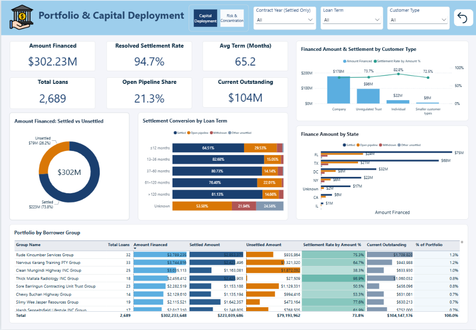
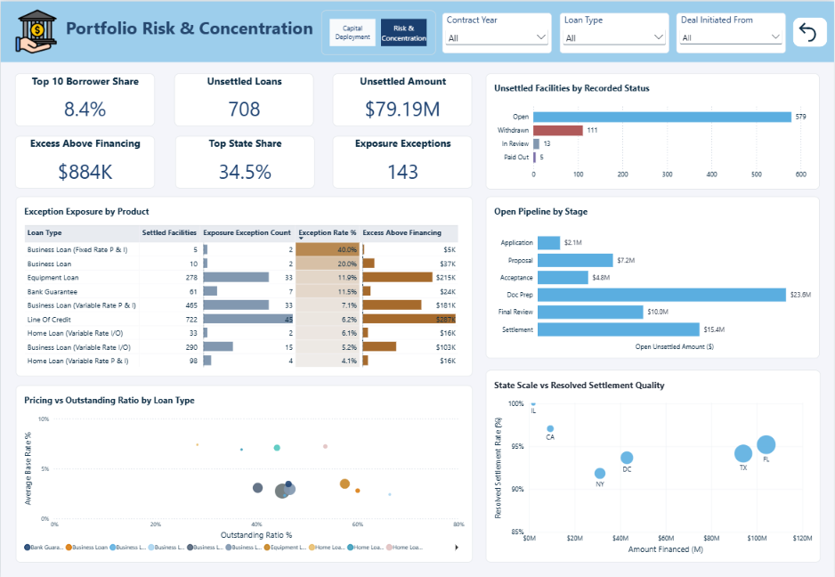
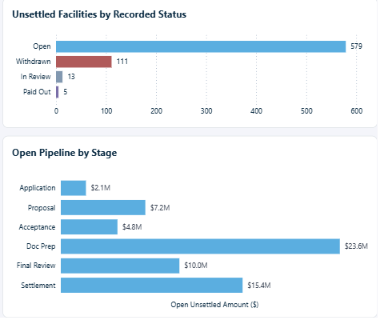
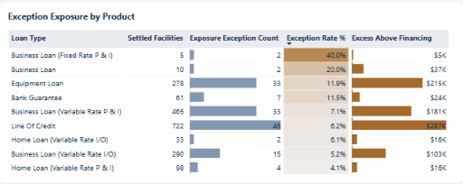

# Commercial Lending Portfolio Analysis

A Power BI portfolio review of **2,689 commercial lending facilities representing $302.23M in financed value**. The analysis separates active pipeline from completed outcomes, evaluates borrower and geographic concentration, and identifies product, vintage and data-quality exceptions requiring further investigation.

The headline settlement rate is **73.8%**, but this understates completed conversion: **21.3% of financed value remains in the open pipeline**, while the **resolved settlement rate is 94.7%**.

\
   \ \

## Table of Contents

- [Problem Statement](#problem-statement)
- [Data Source](#data-source)
- [Architecture](#architecture)
- [Analytical Framework](#analytical-framework)
- [Key Measures](#key-measures)
- [Business Insights](#business-insights)
  - [Capital Deployment](#capital-deployment)
  - [Risk & Concentration](#risk--concentration)
  - [Pipeline](#pipeline)
  - [Exceptions](#exceptions)
- [Data Quality & Limitations](#data-quality--limitations)
- [Recommendations](#recommendations)
- [Project Files](#project-files)

---

## Problem Statement

The project addresses four portfolio-management questions:

1. **Is deployed capital translating into healthy settlement outcomes?**
2. **Is exposure becoming concentrated by borrower, geography or product?**
3. **Which segments remain weaker after active pipeline is separated from completed outcomes?**
4. **Where do exposure or data-quality exceptions require investigation?**

A key analytical distinction is made between facilities that have **not yet settled** and those that have reached a negative resolved outcome. This avoids treating active applications as failed conversion.

---

## Data Source

The Power BI model combines four source datasets:

| Dataset                              | Purpose                                                                   |
| ------------------------------------ | ------------------------------------------------------------------------- |
| `credit_facilities.xlsx`             | Facility, borrower, status, loan term, product and origination attributes |
| `loan_financials.xlsx`               | Receivable linkage and current outstanding balances                       |
| `business_categories_hierarchy.xlsx` | Industry classification hierarchy                                         |
| `state_reference.xlsx`               | State and geographic reference data                                       |

Source files are loaded through Power Query. A parameterised `FolderPath` controls the source directory so the model can be moved between environments without rewriting each file path.

---

## Architecture

All transformation and analysis are performed inside Power BI.

| Layer | Tool               | Purpose                                                             |
| ----- | ------------------ | ------------------------------------------------------------------- |
| 1     | Excel source files | Facility, financial, industry and state reference data              |
| 2     | Power Query        | Data typing, cleaning, joins and reusable source-path parameter     |
| 3     | Semantic model     | Relationships, calculated classifications and explicit DAX measures |
| 4     | Power BI report    | Capital deployment and risk/concentration analysis                  |

The final report contains two analytical pages:

- **Capital Deployment** — portfolio size, conversion, open pipeline, borrower and geographic exposure.
- **Risk & Concentration** — unresolved status, pipeline stage, exposure exceptions, pricing and state risk.

---

## Analytical Framework

The analysis uses the following definitions:

- **Settled** — a facility with a Receivable ID.
- **Unsettled** — a facility without a Receivable ID.
- **Open Pipeline** — an unsettled facility where `Status = Open`.
- **Withdrawn** — an unsettled facility where `Status = Withdrawn`.
- **Resolved Settlement Rate** — settled financed value divided by settled plus withdrawn financed value.
- **Open Pipeline Share** — open unsettled financed value divided by total financed value.
- **Exposure Exception** — a settled facility where current outstanding exceeds original financed value.
- **Exception Rate** — exposure exceptions divided by settled facilities.

`Contract Year` applies only to settled facilities because unsettled records do not contain a Contract Date.

---

## Key Measures

| Measure                  | Portfolio Value |
| ------------------------ | --------------: |
| Total Facilities         |           2,689 |
| Amount Financed          |        $302.23M |
| Settled Amount           |        $223.04M |
| Headline Settlement Rate |           73.8% |
| Resolved Settlement Rate |           94.7% |
| Open Pipeline Amount     |         $64.44M |
| Open Pipeline Share      |           21.3% |
| Current Outstanding      |        $104.15M |
| Top 10 Borrower Share    |            8.4% |
| Top State Share          |           34.5% |
| Exposure Exceptions      |             143 |
| Exception Rate           |            7.2% |
| Excess Above Financing   |           $884K |

---

## Business Insights

### Capital Deployment

\
   \ \

- **Headline settlement understates completed conversion.** Although 73.8% of financed value has settled, most unsettled value is still active. The resolved settlement rate rises to **94.7%**.
- **The open pipeline is material.** Approximately **$64.44M**, or **21.3% of total financed value**, remains Open.
- **Short-term lending appears weaker mainly because more business remains unresolved.** Facilities at 12 months or less settle at **64.5%** headline, but approximately **92.8%** on resolved outcomes.
- **Borrower concentration is modest.** The ten largest borrower groups account for only **8.4%** of financed value.
- **Geographic concentration is more material.** Florida alone represents approximately **34.5%** of financed value.

### Risk & Concentration

\

&#x20; \
\

- **Texas is not a broad conversion problem.** Its headline settlement rate is weaker than the rest of the portfolio, but the difference narrows materially once unresolved applications are removed.
- **Recent Texas vintages provide a stronger risk signal.** Texas contracts from 2021–22 record an exception rate of approximately **10.9%**, compared with **5.7% for Florida**.
- **Bank Guarantee remains weak after pipeline is removed.** Its resolved settlement rate is approximately **86.1%**, materially below the roughly 95% level recorded by most other large products.

### Pipeline

\
   \ \

Most unsettled facilities remain active rather than withdrawn. The largest open balance sits at **Doc Prep**, with further material value already at Final Review and Settlement.

The data does not include application age or time-in-stage, so the current model can identify where pipeline sits but cannot determine whether cases are progressing normally or have stalled.

### Exceptions

\

&#x20; \
\

There are **143 exposure exceptions**, representing approximately **$884K in excess above original financing**.

Raw counts alone can be misleading:

- **Equipment Loan:** approximately **11.9% exception rate**
- **Bank Guarantee:** approximately **11.5%**
- **Line of Credit:** approximately **6.2%**, despite having the highest raw exception count

This indicates that exception **rate and denominator size** are more useful than count alone.

Recent Texas vintages reinforce the same point:

\

&#x20; \
\

Texas exception rates rise materially in 2021–22, while Florida remains comparatively stable.

---

## Data Quality & Limitations

Several findings should be interpreted with data limitations in mind:

- **63 Asset Finance Limit – Reducing facilities**, representing approximately **$7.04M**, have no settled linkage.
- **29 are at Final Review or later**, including **24 at Settlement, Complete or Booked**.
- **20 facilities have no recorded term**, and 19 are already Complete or Booked.
- Some Paid Out facilities do not contain a Receivable ID.
- Unsettled facilities have no Contract Date, so contract-year analysis covers settled business only.
- Application age and time-in-stage are unavailable.
- Very high rates in small populations should be treated as indicative rather than representative.

These issues suggest that some apparent underperformance reflects lifecycle or source-system reconciliation rather than commercial performance.

---

## Recommendations

1. **Add pipeline ageing and time-in-stage.** Capture application age, current-stage duration, outstanding documentation and withdrawal reason.
2. **Monitor Texas by contract vintage.** Combine resolved settlement, open pipeline and exception rate rather than relying on headline settlement alone.
3. **Review Bank Guarantee separately.** Investigate withdrawal reasons, approval conditions and customer/channel mix.
4. **Formalise exception reconciliation.** Maintain an exception register including facility, product, state, contract year, excess amount, cause, owner and remediation status.

---

## Project Files

- [Power BI Report](Commercial_Lending_Portfolio.pbix)
- [Key Takeaways Report — Word](Commercial_Lending_Key_Takeaways_Report.docx)

### Tools

- Power BI
- Power Query
- DAX
